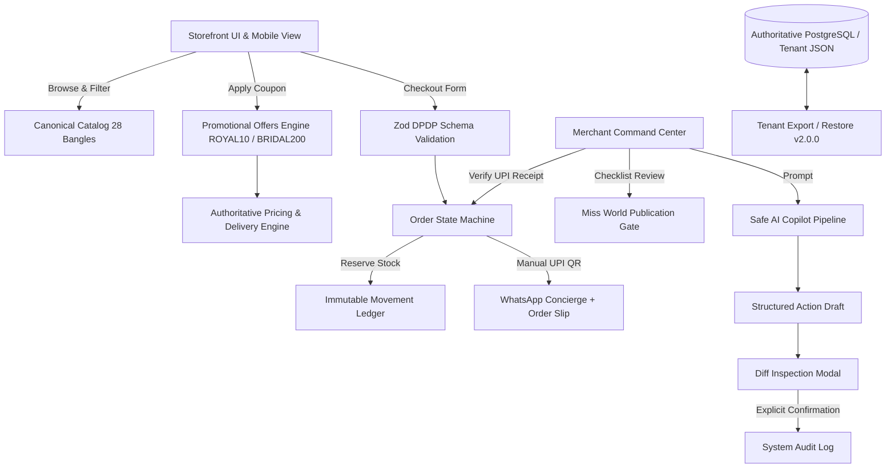
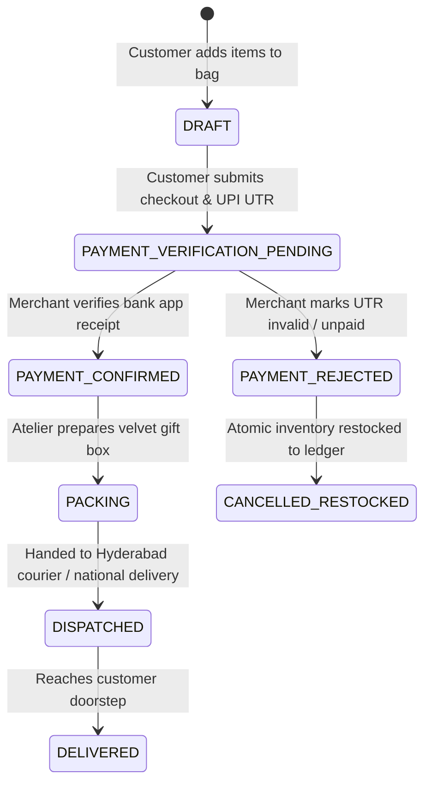
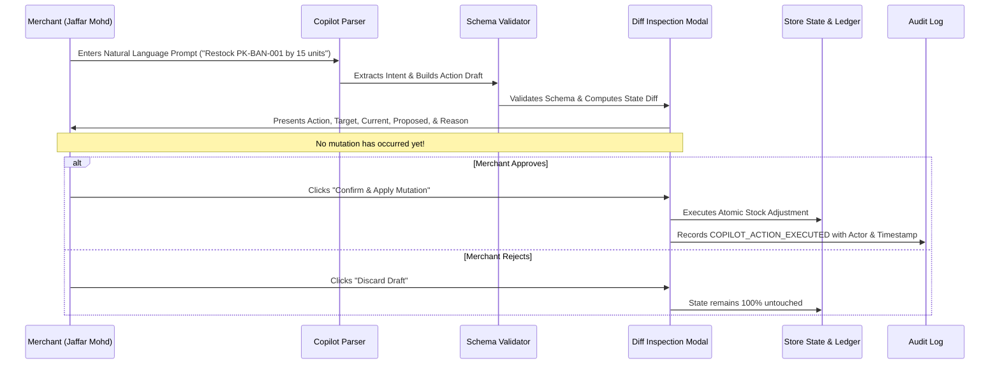

# 🏛️ QuickStore Architecture Specification — Premium Khaja

## 1. System Overview & Core Tenets

QuickStore is a portable, mobile-first headless commerce and digital showroom architecture designed for artisanal luxury brands. **Premium Khaja** (Hyderabad, India) is its flagship tenant.

### Core Architectural Tenets:
1. **Multi-Tenant Foundation from Day 1**: All entities partition cleanly by `tenant_id`.
2. **Authoritative Server / Context Logic**: Never trust client pricing, promotional deductions, or claim assertions.
3. **Manual Payment Collection (Zero Payment Gateway Fees)**: Strict separation between `payment_verification_pending` and `payment_verified`.
4. **Human-in-the-Loop Safe AI**: Schema validation and explicit human confirmation before any mutation occurs.
5. **Portability & Disaster Recovery**: Authoritative PostgreSQL schema and self-contained JSON backup format v2.0.0.

---

## 2. Architecture Diagram

---

## 3. Order Lifecycle & Manual UPI Verification

---

## 4. Miss World Publication Gate (Section 4)

Claims regarding pageant gifting are subject to legal scrutiny and brand protection:
- **Default State:** `draft_unverified`
- **Fallback Copy:** Conservative copy displayed across all public channels:
  `"Couture Runway & High-Fashion Showcase — Adorning global cultural ambassadors and international runway delegates."`
- **Gated Elements:** High-risk celebrity slides and explicit Miss World winner claims are hidden from public carousels until the 4-point verification checklist is completed by Jaffar Mohd:
  1. Recipient Identity Verified (`Krystyna Pyszková`)
  2. Event Name & Date Verified (`71st Miss World Festival`)
  3. Rights-Cleared Photography Uploaded
  4. Legal Wording Reviewed

---

## 5. Safe AI Copilot Pipeline (Section 10)

---

## 6. Portability & Disaster Recovery (Format v2.0.0)

All tenant data exports conform to a self-contained JSON schema:
- **Manifest:** Format version (`2.0.0`), tenant identifier, exported timestamp, entity counts.
- **Tenant Config:** Brand identity, owner contact, UPI configuration, delivery fee thresholds.
- **Entities:** Products, inventory records, immutable inventory movement ledger, customer CRM profiles, active campaign slides, claim gate state, promotional discount rules, and audit logs.
- **Verification Runner:** `scripts/verify-restore/verifyRestore.ts` executes standalone restoration and smoke test checking cryptographic checksums and catalog integrity.
